# StreamBoss on Roku: install and use

StreamBoss for Roku is a separate, native channel (Roku cannot run the Flutter app). It is a **player
only**: you bring your own Xtream Codes login or M3U playlist from a service you are licensed to watch.

> **Status.** The channel compiles and its logic is tested in CI, but its screens have not yet been tried on
> a real Roku. If something looks or behaves differently from this guide, that is a bug: please say what you
> saw. See [Troubleshooting](#troubleshooting).

## What you need

- A Roku player or TV with a recent Roku OS, on the same network as a computer.
- A computer with a web browser.
- Your provider's details: either an **Xtream** server URL, username and password, or an **M3U playlist URL**.

## Install (the easy way: the installer program)

Instead of the browser steps below, run the **StreamBoss Roku installer**. It finds your Roku, downloads the
newest channel, sends it to the Roku and starts it, so there is no zip to handle and no upload page.

1. Download the installer for your computer from the
   [downloads page](https://streamboss.site/downloads/) (open the newest version):
   `StreamBoss-<version>-roku-installer-windows.exe`, `...-macos.zip` (Apple silicon) or `...-linux.tar.gz`.
   - **Windows:** double-click it. If Windows SmartScreen warns, choose *More info* then *Run anyway* (the file
     is not code-signed).
   - **macOS:** unzip it (double-click the .zip) and double-click **Install StreamBoss on Roku.command**. It opens
     Terminal and runs the installer. The first time macOS may say it cannot verify the file (it is not
     notarized): right-click the file, choose *Open*, then *Open* again. If you moved the files apart, keep
     `roku-installer` next to the `.command` file. Intel Macs: use the browser steps below.
   - **Linux:** `tar xzf StreamBoss-*-roku-installer-linux.tar.gz && ./roku-installer` in a terminal.
2. A page opens in your browser (it is served by the installer on your own computer, nothing goes to the internet
   but the download of the channel). It lists the Rokus on your network and you pick one (or type the address
   from Roku **Settings > Network > About**). The computer must be on the same network as the Roku.
3. If **developer mode** is off, the page says so and has a button, **Open Developer Settings on my TV**, that sends
   the remote's secret key sequence. On the TV choose **Enable installer and restart**, accept the licence,
   **choose a password** and wait for the restart, then press **Check again**. This one step has to be done on
   the TV.
4. Type that password and press **Install StreamBoss**. The page shows each step (download, send, start) and
   says when StreamBoss is on the Roku. Closing the tab closes the installer.

If no page opens, the installer prints an address that starts with `http://127.0.0.1:`; open it in a browser.

Terminal version, for scripts or a computer with no browser: `--cli` asks the same questions in the terminal, and
`--ip 192.168.1.40 --password ...` does it without asking. Other options: `--zip StreamBoss-...-roku.zip` (use that
channel file instead of downloading), `--no-launch` (do not start it), `--no-browser` (do not open the page).
If the Roku has *Settings > System > Advanced system settings > Control by mobile apps* set to **Disabled** or
**Limited**, the installer cannot press keys for you and cannot start the channel; it says so, and you do those
two things by hand.

**If it says "Install Failure: Compilation Failed"** the Roku accepted the file but could not compile the channel.
The Roku prints the exact line on its debug console: the installer reads it and shows it under the error (send me
those lines). To see it yourself, before installing run `telnet <the Roku's address> 8085` (on a Mac or Linux
`nc <address> 8085`), install again from another window and read what scrolls past; `Syntax Error` lines name the
file and line.

> The installer is tested against a stand-in for a Roku's developer web server, not against a real Roku. If it
> does not work on yours, use the browser steps below and tell me what it printed.

## Language

The channel speaks English, Spanish, Italian and Portuguese. It follows the language of the Roku (Settings > System >
Language) when that is one of the four, and otherwise uses English. To pick one yourself: **Settings tab > Language**,
press OK to go round: Device language, English, Español, Italiano, Português. The change shows at once. What stays as
it is: channel and title names (they come from your provider) and the Roku's own system dialogs, such as the
keyboard, which follow the Roku's language.

## Install by hand (browser)


The channel is not in the Roku Channel Store, so it is installed through the Roku's developer mode.

### 1. Get the channel file

Download `StreamBoss-<version>-roku.zip` from the
[downloads page](https://streamboss.site/downloads/) (open the newest version).
Do not unzip it. (Building from source instead: see [For developers](#for-developers).)

### 2. Turn on developer mode on the Roku

1. With the Roku remote, press **Home** three times, **Up** twice, **Right**, **Left**, **Right**, **Left**,
   **Right**.
2. The Developer Settings screen opens. Choose **Enable installer and restart** and accept the licence.
3. Choose a **web server password** (you will need it in the next step) and note the **IP address** shown
   on the screen (for example `192.168.1.40`). The Roku restarts.

### 3. Upload the channel

1. On your computer open `http://<the Roku's IP address>` in a browser.
2. Sign in with user name `rokudev` and the password you chose.
3. Press **Upload**, pick the zip, then **Install**.
4. The Roku shows the channel straight away. It also stays on the Roku's home screen, at the end of the
   channel list, as **StreamBoss**, until you remove it.

### Updating and removing

- **Update:** repeat step 3 with the newer zip. It replaces the old one (a Roku keeps one sideloaded channel
  at a time, so installing a different dev channel replaces StreamBoss).
- **Remove:** on the same web page press **Delete**. That should also remove what the channel saved (your
  login, My List and resume positions); set it up again if you reinstall.

## First start: connect your provider

The first time, StreamBoss opens the **Connect your provider** screen
([wireframes 1 to 3](#wireframes-and-layout)).

1. **Source type** switches between **Xtream** and **M3U playlist** (press OK on it).
2. For **Xtream** fill in **Server URL** (include `http://` and the port, e.g. `http://host:8080`),
   **Username** and **Password**. For **M3U** fill in **Playlist URL**.
   Press OK on a row to open the Roku keyboard, type, and choose **OK**.
3. Choose **Connect**. The status line at the top shows "Loading your library..." and then the counts of
   channels, movies and series.
4. No provider yet? Choose **Try demo mode** for a few public test streams.

Typing with the remote is slow. The **Roku mobile app** (iOS and Android) has a remote with a keyboard that
types into these fields much faster.

Your login is stored on the Roku (in the channel's own storage) and is used the next time the channel opens,
which then goes straight to your library.

## Using it

The main screen has three columns: **Tabs** on the left, **Categories** in the middle and **Items** on the
right ([wireframe 4](#wireframes-and-layout)).

| Tab | What it does |
|---|---|
| **Live** | Your live channels, by category. OK plays one. |
| **Movies** | Your movies, by category. OK plays one (and resumes where you stopped). |
| **Series** | Your series, by category. OK on a series lists its **episodes** (Xtream only); OK on an episode plays it. Back returns to the series list. |
| **My List** | Titles you marked with `*`. |
| **Search** | OK opens the keyboard; the matching channels, movies and series (up to 300) fill the list. |
| **Settings** | **Reload library**, **Change source**, **Clear My List**, **Clear resume history**, **About StreamBoss**. |

### Remote control

| Button | On the browse screen | While watching |
|---|---|---|
| **Up / Down** | Move in the list | **Live:** next / previous channel |
| **Left / Right** | Move between the columns | Roku's player: skip back / forward |
| **OK** | Select / open / play | Pause / play |
| **Back** | One step up: Items, then Categories, then Tabs | Close the video |
| **\*** (Options) | Add to or remove from **My List** (a `*` shows in front of the title) | |

### Good to know

- **Resume:** movies and episodes remember where you stopped (the last 3 percent counts as finished).
- **Zapping:** while a live channel plays, Up and Down switch channels in the list you started from.
- **Sizes:** My List holds **40** titles and resume history **80**, because a Roku channel's storage is only
  32 KB. A list shows at most 3,000 titles at once (use categories or Search for the rest).
- **Formats:** Roku plays HLS, MP4 and some MKV/TS. A stream it cannot decode shows a playback error in the
  status line and goes back to the list.
- **Not included** (compared with the other StreamBoss apps): TMDB posters and details, TV guide (EPG),
  subtitle styling, shaders, languages and filters, profiles. These live in the Flutter apps.

## Wireframes and layout

All screens are 1280 x 720 (HD). They are drawn from the real channel source
([`roku/components/MainScene.xml`](../roku/components/MainScene.xml) and `MainScene.brs`); the pictures are
schematic (placeholder titles), the positions and sizes are real. A one-page sheet of all twelve is in
[`roku/wireframes-sheet.png`](roku/wireframes-sheet.png).

### Setup

| 1. Xtream | 2. M3U playlist | 3. Keyboard |
|---|---|---|
| 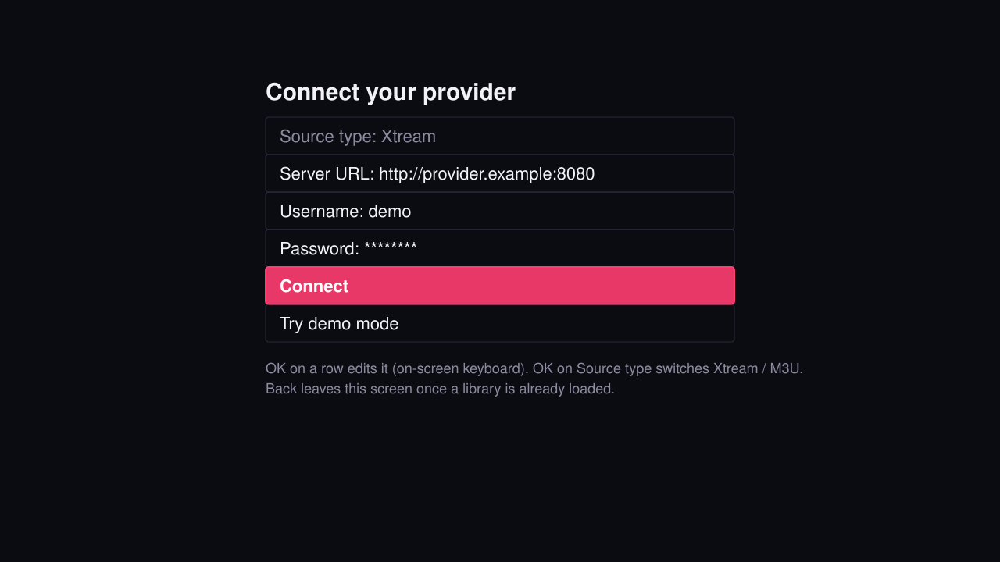 | 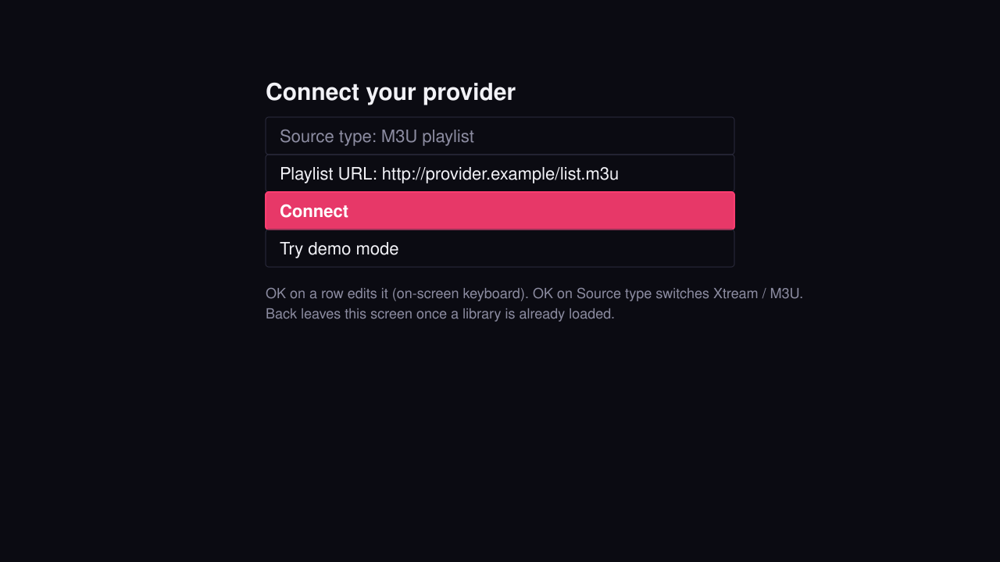 | 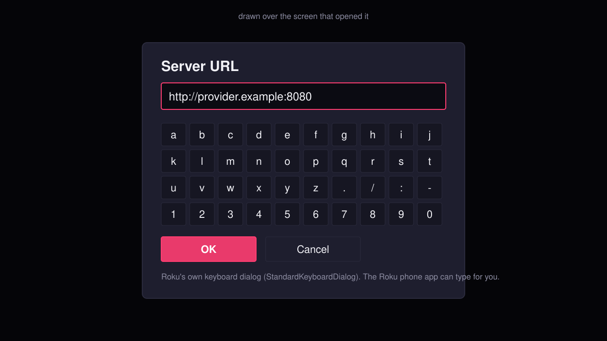 |

### Browse

| 4. Live | 5. Movies | 6. Series: episodes |
|---|---|---|
| 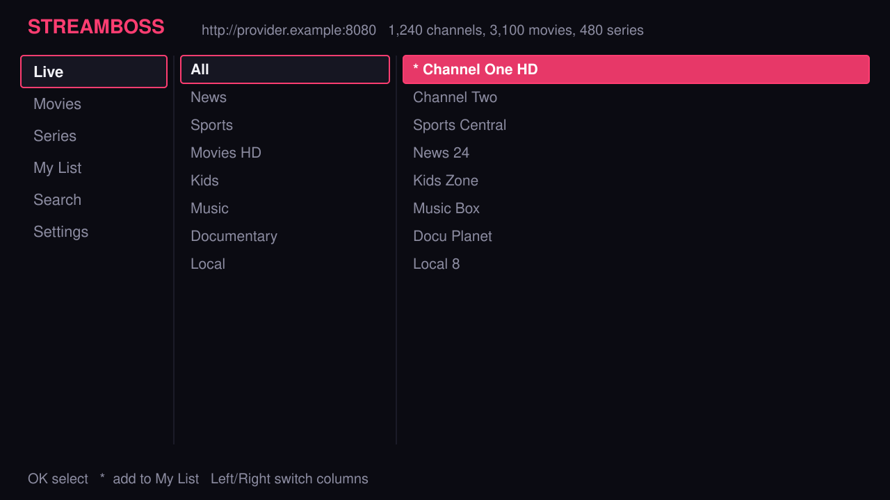 | 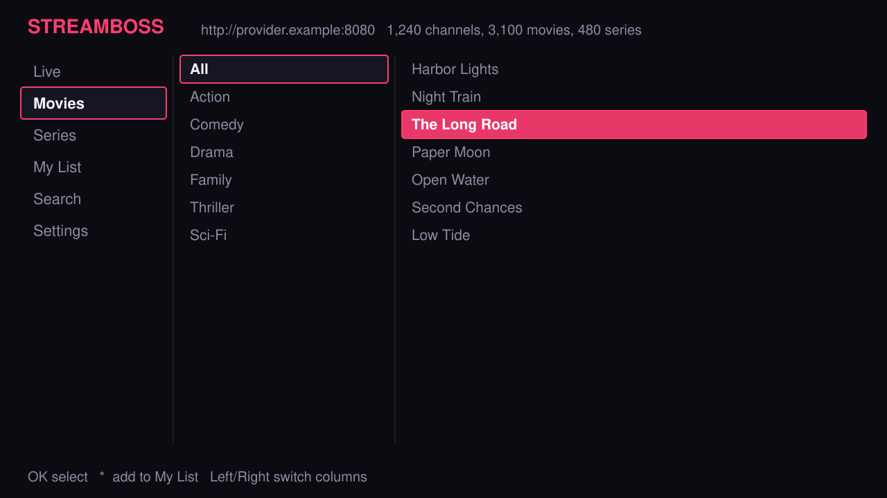 | 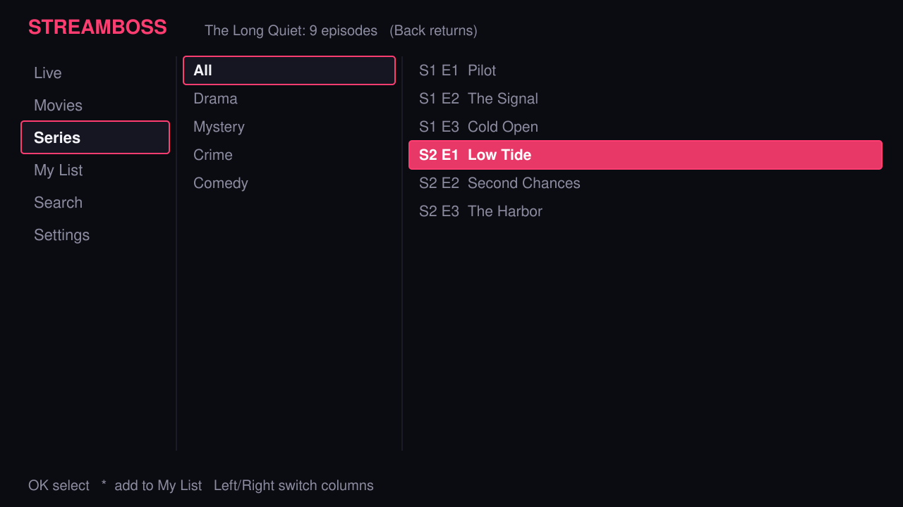 |

| 7. My List | 8. Search results | 9. Settings |
|---|---|---|
| 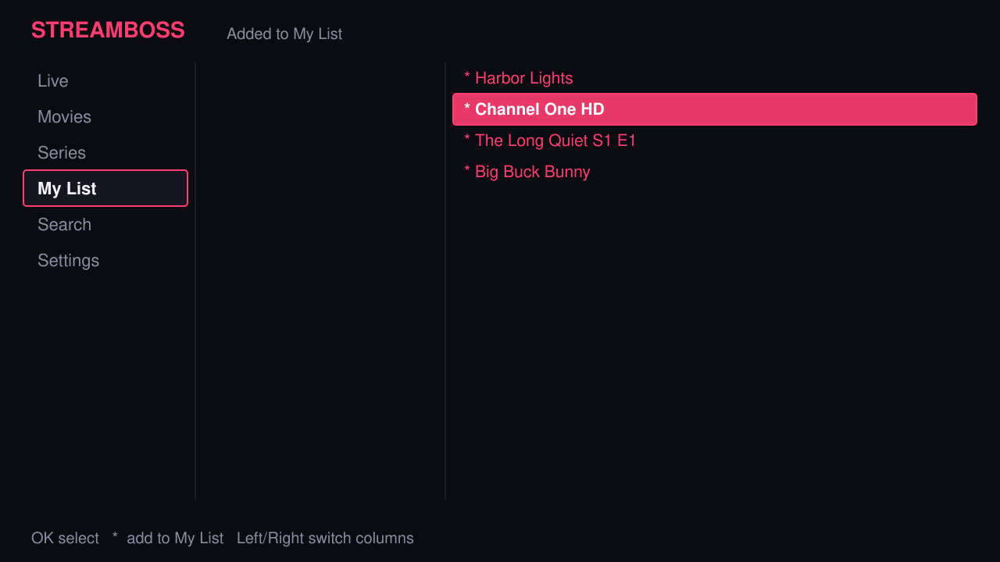 | 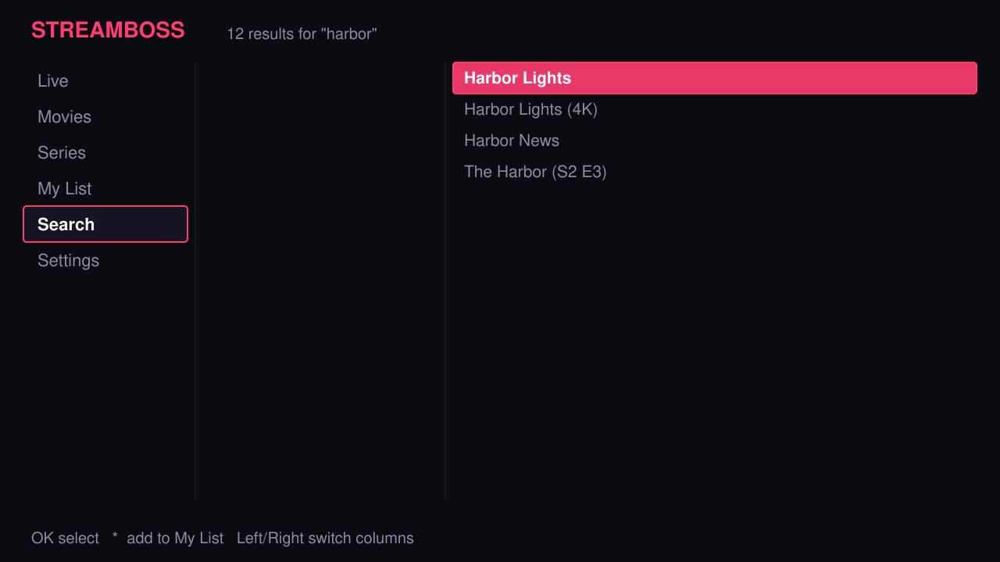 | 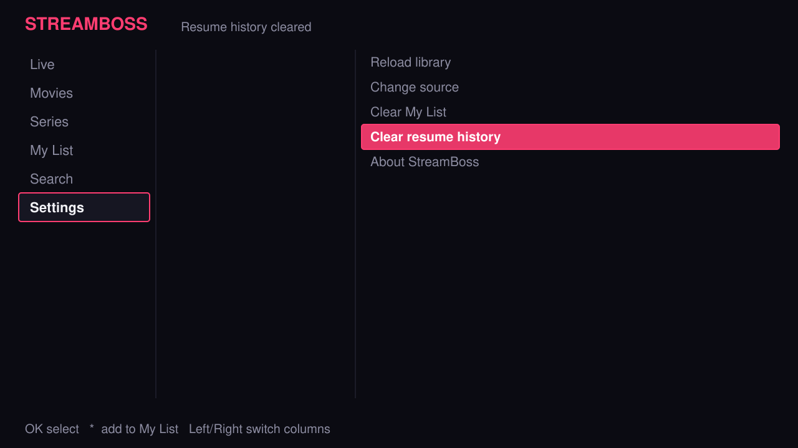 |

### Playback

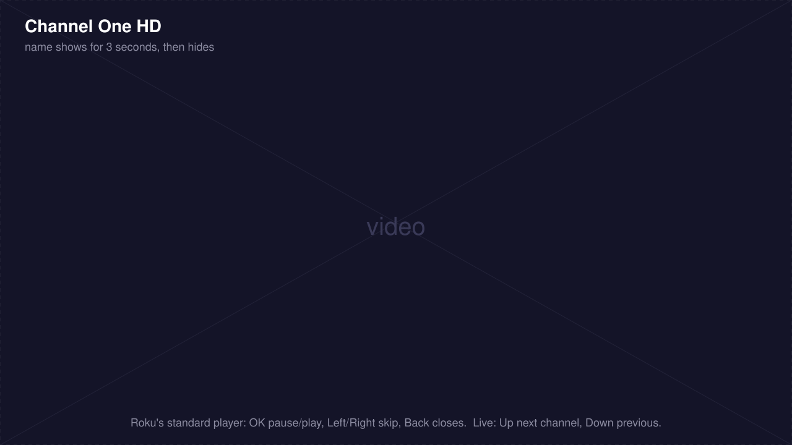

The video covers the whole screen. The channel or title name shows for three seconds in the top left, then
hides. Live channels: Up / Down zap. Everything else uses Roku's standard player controls.

### Layout and sizes

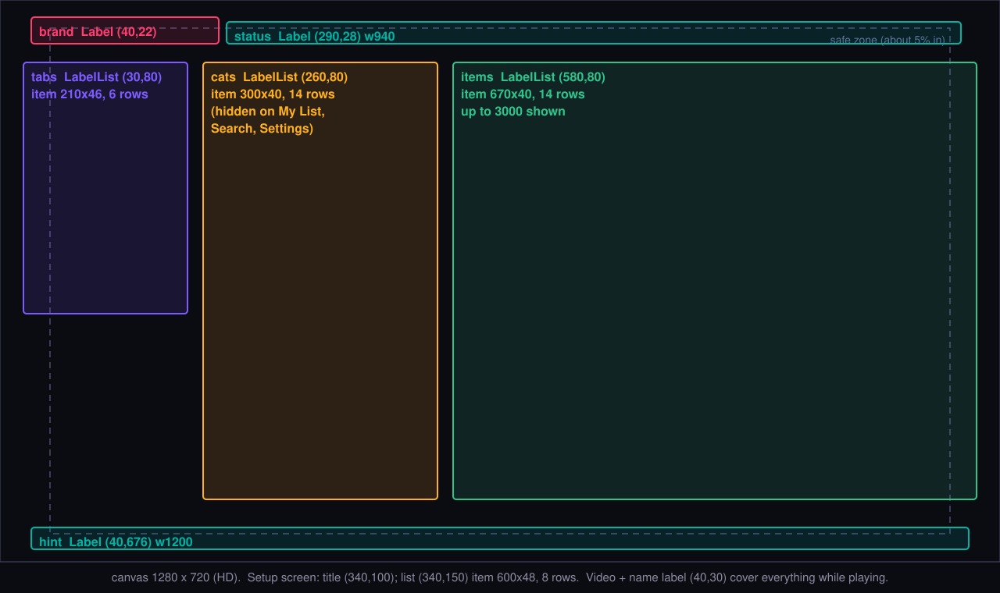

| Part | Kind | Position (x, y) | Size |
|---|---|---|---|
| Brand "STREAMBOSS" | Label | 40, 22 | |
| Status line | Label | 290, 28 | 940 wide |
| Tabs | LabelList | 30, 80 | rows 210 x 46, 6 shown |
| Categories | LabelList | 260, 80 | rows 300 x 40, 14 shown |
| Items | LabelList | 580, 80 | rows 670 x 40, 14 shown, up to 3,000 |
| Key hint | Label | 40, 676 | 1,200 wide |
| Setup title | Label | 340, 100 | |
| Setup list | LabelList | 340, 150 | rows 600 x 48, up to 8 |
| Video | Video | 0, 0 | 1280 x 720 |
| Channel name overlay | Label | 40, 30 | 1,200 wide, shows 3 s |

Colours: background `#0B0B12`, brand pink `#FF3D71`, secondary text `#8C8CA1`.

**A note on screen edges.** Roku suggests keeping text inside a "safe zone" about 5 percent in from each
edge, because some TVs crop the picture. The status line, tabs and item list sit 28 to 40 pixels from the
edge (about 3 percent), so on a TV that crops (overscans) the edges, the first letters might be clipped.
Moving everything in by about 20 pixels would fix that; tell me if you see it.

### Where focus goes

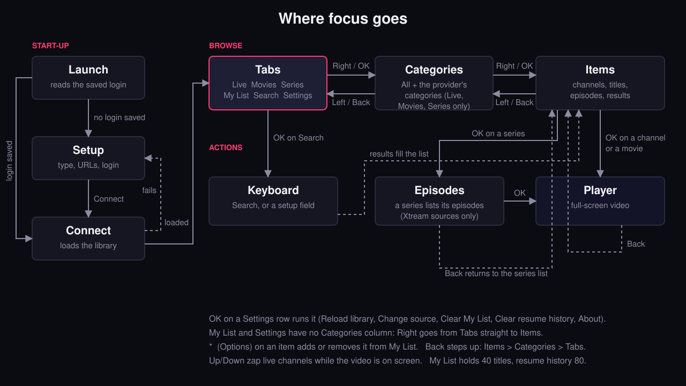

## Troubleshooting

| Problem | What to try |
|---|---|
| The key sequence does nothing | Press the buttons one after another without pausing, starting from the Home screen. Some Roku models and OS versions put Developer Settings in a different place; search "Roku enable developer mode" for your model. |
| `http://<ip>` does not open | The computer and the Roku must be on the same network. Check the IP shown on the Roku (Settings > Network > About). A VPN on the computer can block it. |
| Sign-in fails | The user name is `rokudev`; the password is the one you set in step 2. To reset it, run the key sequence again and set a new one. |
| "Install Failure: Compilation Failed" | Use the zip from the Releases page unchanged. If you made your own zip, `manifest` must be at the **top** of the zip, not inside a folder. |
| "Could not connect: ..." | Check the URL (include `http://` and the port), the user name and the password, and that your provider is up. For M3U, open the playlist address in a browser to see whether it downloads. |
| Loading takes a long time or never finishes | A very large library can be slow on a small Roku. Try a playlist with fewer channels, or choose Settings > Reload library. |
| "Playback error" | The stream's format may not be supported by Roku (it plays HLS, MP4 and some MKV/TS). Try another channel. |
| "Series are only available on Xtream sources" | Episodes need an Xtream login. An M3U playlist has no episode list. |
| My List is full | It holds 40 titles; remove one with `*`. |
| Characters are hard to type | Use the Roku mobile app's keyboard. |

## For developers

The channel is plain SceneGraph / BrightScript in [`roku/`](../roku/): `source/main.brs` starts the scene,
`components/MainScene.*` is the whole UI, `components/lib/Common.brs` holds the parsing and storage helpers,
and `components/tasks/FetchTask.*` loads libraries off the UI thread.

```sh
npm i -g brighterscript brs-node
cd roku
bsc --project bsconfig.json --copyToStaging=false --createPackage=false     # compile + lint
brs-cli components/lib/Common.brs tests/common.test.brs                      # logic tests
zip -r ../StreamBoss-dev-roku.zip manifest source components images          # the file to sideload
```

CI builds the same zip on every push (the `streamboss-roku` artifact of the Build run) and the Release
workflow attaches it as `StreamBoss-<version>-roku.zip`.

To regenerate the wireframes after changing the UI: `python3 tool/roku_wireframes.py docs/roku/wireframes`.
